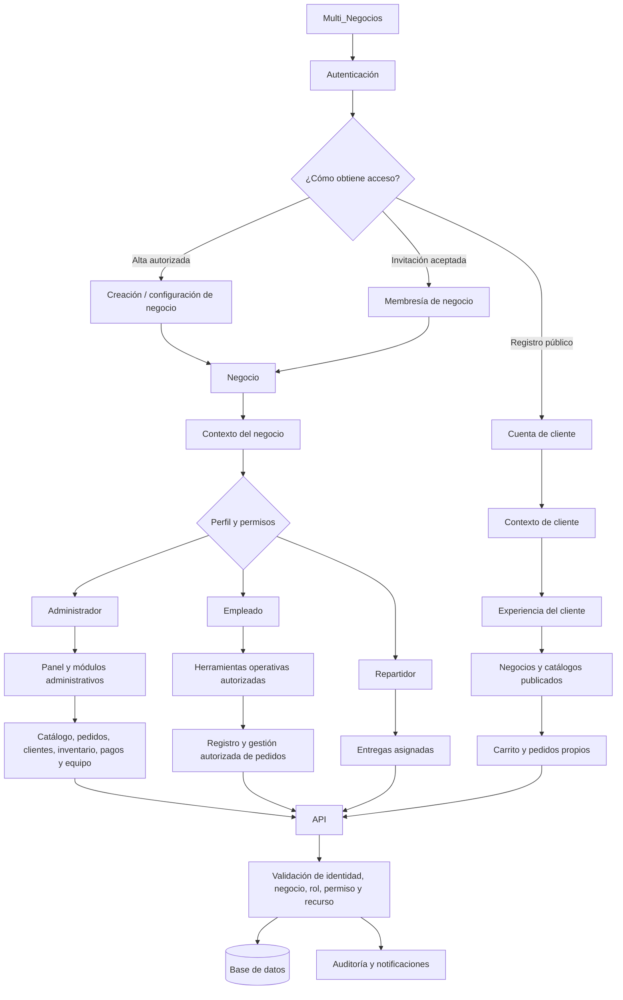
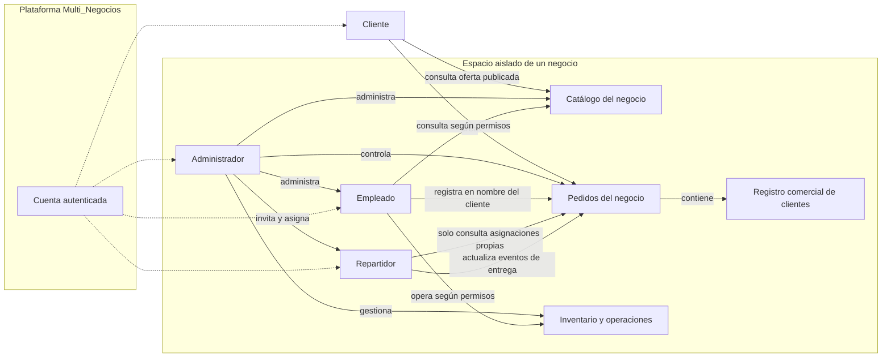
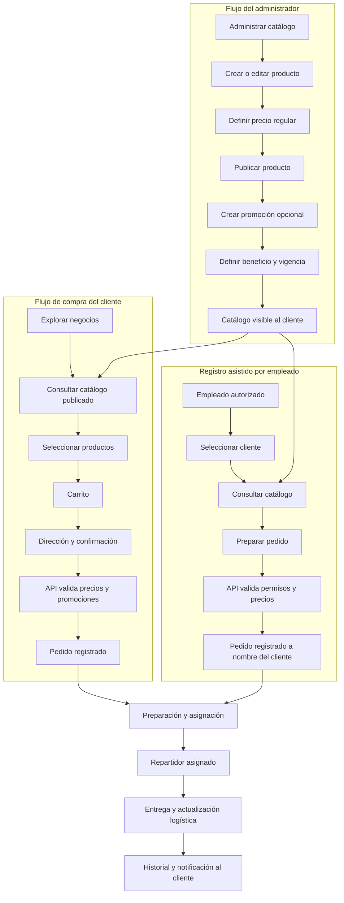

# Esquema funcional de la aplicación Multi_Negocios

Este documento describe la estructura de navegación y módulos por perfil. No representa pantallas implementadas ni sustituye la matriz de permisos del backend.

## Mapa visual general de la aplicación

El siguiente mapa representa las relaciones principales entre personas, negocio, módulos y servicios. Las flechas indican el recorrido o la dependencia funcional, no una autorización automática.

## Mapa de relaciones entre perfiles y negocio

## Mapa de los flujos comerciales principales

### Lectura de los diagramas
- Cada negocio constituye un espacio aislado. Sus productos, precios, promociones, clientes, pedidos, miembros e inventario no se mezclan con los de otros negocios.
- Una cuenta autenticada puede tener más de una relación, pero cada operación se evalúa dentro del contexto activo y sus permisos.
- El catálogo administrativo es la fuente de publicación de productos y promociones; el cliente consume únicamente la oferta publicada.
- Los pedidos creados por el cliente y los registrados por un empleado convergen en el mismo flujo. Se conserva quién es el cliente y quién creó realmente el pedido.
- La asignación de reparto conecta un pedido con un repartidor concreto. El repartidor no obtiene acceso general al negocio.
- La API es el punto de control obligatorio antes de leer o modificar datos.

## 1. Entrada común
1. Inicio de sesión.
2. Registro de cuenta de cliente.
3. Recuperación de acceso.
4. Recepción y aceptación de invitación.
5. Selección de contexto cuando la cuenta tenga más de una relación autorizada.
6. Acceso al espacio correspondiente al perfil activo.

El registro público crea una cuenta de cliente. Las membresías de empleado y repartidor se crean mediante invitación aceptada y validada por el servidor. La creación de un negocio utiliza un flujo separado.

## 2. Experiencia del cliente
Navegación principal:
- **Inicio:** descubrir y seleccionar negocios disponibles.
- **Mis pedidos:** pedidos activos, seguimiento, historial y detalle.
- **Mi perfil:** datos personales y direcciones.
- **Notificaciones:** avisos de pedidos, pagos y comunicaciones permitidas.

Flujos:
- Negocios → detalle del negocio → catálogo → producto → carrito → dirección → confirmación y pago → resultado del pedido.
- Mis pedidos → detalle → seguimiento o historial.
- Mi perfil → direcciones, preferencias, configuración, seguridad y privacidad.

Restricciones: solo consulta y modifica su propia cuenta, direcciones, preferencias y pedidos mediante acciones habilitadas. En el catálogo del negocio únicamente consulta productos y promociones publicados y disponibles; no ve herramientas internas de administración.

## 3. Experiencia del administrador
Navegación y módulos:
- **Resumen:** indicadores y actividad del negocio.
- **Pedidos:** listado, detalle, registro, cambios permitidos y asignación de reparto.
- **Clientes:** listado y ficha comercial.
- **Catálogo del negocio:** crear, editar, publicar, pausar y retirar productos; administrar categorías, imágenes, precios regulares y promociones.
- **Inventario:** existencias y movimientos, cuando el módulo esté activo.
- **Ventas y pagos:** operaciones, cartera y reportes del negocio.
- **Equipo:** empleados, repartidores, invitaciones, membresías y permisos.
- **Configuración:** datos del negocio, módulos y preferencias.

El administrador solo opera dentro de su negocio. Es responsable de mantener su catálogo, precios y promociones. Las acciones sensibles requieren confirmación y registro de auditoría.

### Gestión del catálogo y promociones
Flujo administrativo: Catálogo → crear producto → completar información e imagen → establecer precio regular → guardar como borrador o publicar → crear promoción opcional → establecer descuento o precio promocional y vigencia → revisar publicación. El administrador puede editar, pausar o retirar productos y promociones. Las condiciones exactas de descuentos, acumulación y límites se definirán antes de programar.

## 4. Experiencia del empleado
Navegación y módulos sujetos a permisos:
- **Inicio operativo:** tareas y pedidos relevantes.
- **Registrar pedido:** buscar o seleccionar cliente, añadir productos, confirmar dirección e instrucciones y registrar el pedido.
- **Pedidos:** consultar y ejecutar cambios autorizados.
- **Clientes:** búsqueda y consulta de información necesaria para atender.
- **Productos:** consulta de catálogo y disponibilidad.
- **Pagos:** registro de pagos solo cuando esté autorizado.
- **Notificaciones:** avisos operativos permitidos.
- **Perfil:** datos propios y cierre de sesión.

El empleado no administra miembros, invitaciones, roles ni configuración general. Puede consultar el catálogo para atender pedidos; crear o editar productos, precios y promociones requiere un permiso específico concedido por el administrador. La pantalla no mostrará acciones para las que no tenga permiso.

## 5. Experiencia del repartidor
Navegación y módulos:
- **Inicio:** resumen de entregas asignadas.
- **Mis entregas:** entregas actuales y próximas asignaciones.
- **Detalle de entrega:** productos o bultos necesarios, dirección e instrucciones mínimas, contacto permitido y estado.
- **Ruta:** orden o indicaciones de recorrido cuando esté disponible.
- **Incidencias:** informar ausencia, dirección incorrecta u otro problema.
- **Historial:** entregas realizadas por el propio repartidor.
- **Perfil:** información propia y cierre de sesión.

El repartidor no registra pedidos, no asigna entregas, no administra el catálogo, no modifica productos, precios o promociones, no edita importes ni consulta pedidos ajenos a sus asignaciones.

## 6. Catálogo inicial de vistas del cliente
1. Inicio de sesión.
2. Registro de cuenta.
3. Selección de negocio.
4. Panel principal del administrador (entrada del perfil administrador; mantener la separación de perfiles).
5. Panel principal del empleado.
6. Panel principal del cliente.
7. Catálogo, carrito y pasarela de pagos.
8. Seguimiento del pedido.
9. Historial y detalle de pedidos.
10. Perfil y direcciones.
11. Centro de notificaciones.
12. Configuración de la cuenta.

Las vistas 09, 10, 11 y 12 han sido aprobadas por el usuario. La aprobación visual no significa que la funcionalidad esté programada. Las vistas 01 a 08 deberán conservar el estado de aprobación que conste en el registro de diseño, sin inferirlo.

## 7. Regla de navegación y autorización
La navegación se construye según el contexto activo y los permisos devueltos por la API. La API vuelve a comprobar permisos en cada operación. El cliente móvil nunca decide por sí solo el rol, la pertenencia a un negocio ni la autorización de una acción.
