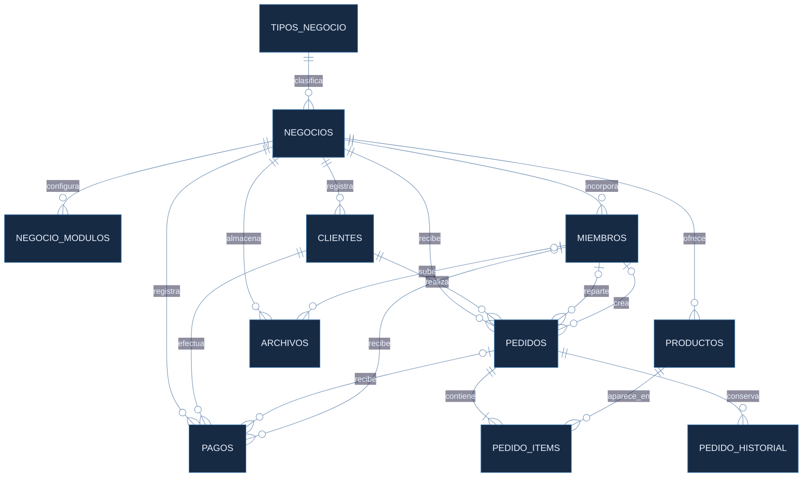
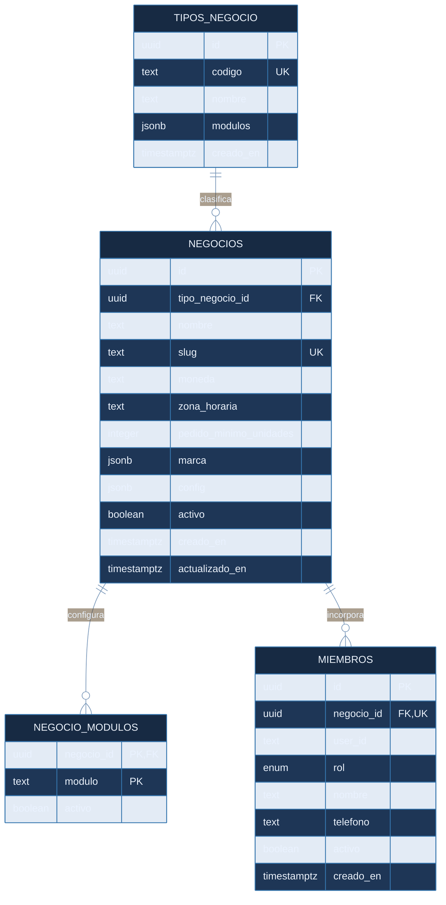
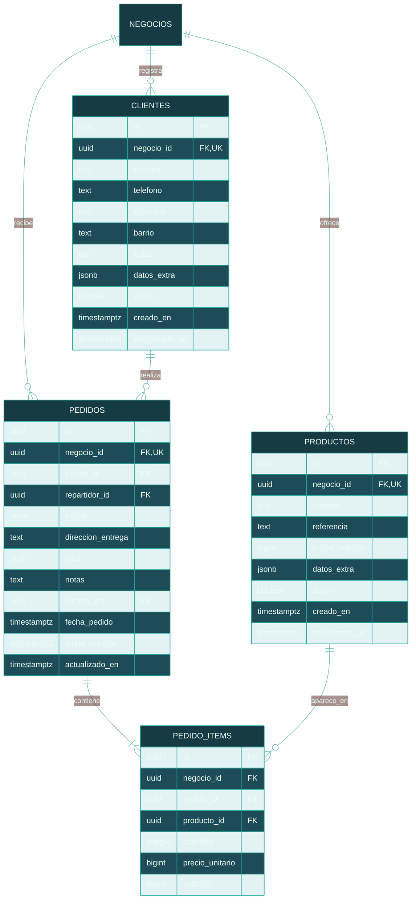
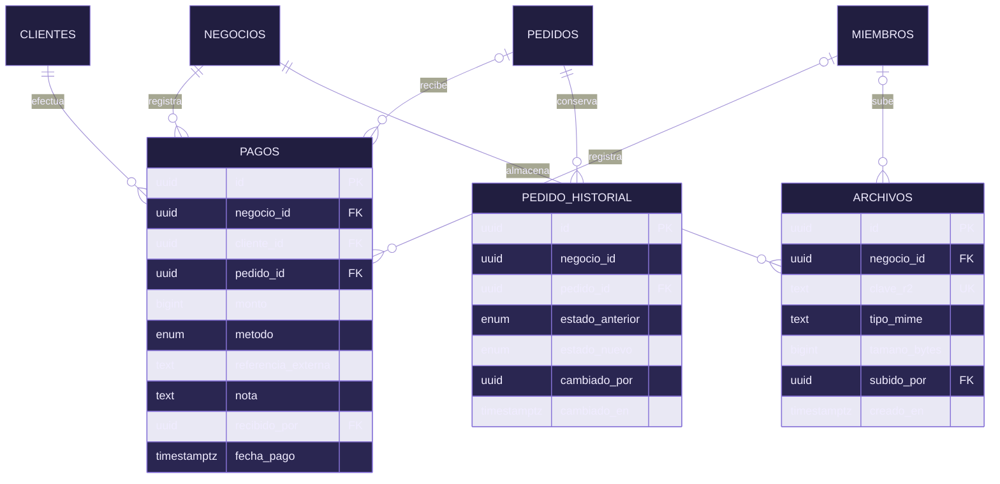
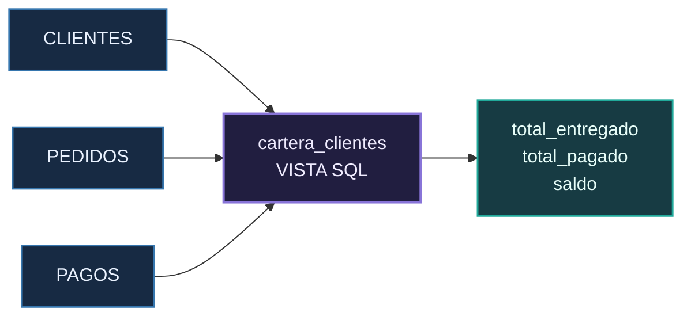

# Modelo entidad-relación (MER) de Multi_Negocios

> **Estado:** documentación del esquema SQL inicial y de sus relaciones declaradas.  
> **Fuente de verdad:** [database/001_esquema_inicial.sql](../database/001_esquema_inicial.sql).  
> Este documento representa el estado actual del SQL; las entidades pendientes se identifican por separado y no se dibujan como tablas implementadas.

## Cómo leer el diagrama

- Cada recuadro representa una tabla real de PostgreSQL.
- **PK** identifica la clave primaria; **FK**, una clave foránea; **UK**, una restricción única.
- Las conexiones muestran relaciones declaradas mediante claves foráneas.
- `1:N` significa que un registro del lado 1 puede relacionarse con varios del lado N.
- Las relaciones opcionales se representan con el círculo del lado correspondiente.
- Los campos que no tienen etiqueta PK/FK/UK son columnas ordinarias.
- Los diagramas están divididos por áreas para facilitar su lectura. Las tablas repetidas en distintas láminas son la misma entidad, no tablas duplicadas.

## 1. Vista general del modelo actual

Este mapa muestra las entidades persistentes y las conexiones principales que ya están definidas en la migración 001.

## 2. Negocios, configuración y acceso

Estas tablas organizan los negocios independientes, los módulos habilitados y las membresías internas.

**Observaciones del modelo actual**
- `NEGOCIO_MODULOS` tiene clave primaria compuesta: `(negocio_id, modulo)`.
- `MIEMBROS` tiene unicidad por `(negocio_id, user_id)` y también por `(negocio_id, id)`, esta última permite referencias compuestas desde otras tablas.
- `MIEMBROS.user_id` está pensado para apuntar a la tabla `user` de Better Auth, pero la FK aparece comentada para ejecutarse después de crear esa tabla. Por tanto, no es todavía una FK activa en la migración 001.

## 3. Clientes, catálogo y pedidos

Esta lámina representa el núcleo comercial: clientes y productos del negocio, pedidos y sus líneas de detalle.

**Observaciones del modelo actual**
- `PEDIDO_ITEMS` conserva el precio unitario aplicado en la venta y calcula el subtotal.
- La migración no conserva todavía una instantánea completa del nombre, descripción, precio regular y promoción aplicada al producto.
- El pedido referencia un cliente y puede referenciar un miembro como repartidor y otro como creador; el modelo actual no representa correctamente al cliente autenticado como creador directo del pedido.

## 4. Pagos, auditoría y archivos

**Observaciones del modelo actual**
- `PEDIDO_HISTORIAL.cambiado_por` no tiene una FK declarada ni identifica todavía de forma polimórfica a cliente, miembro o sistema.
- `ARCHIVOS.subido_por` referencia opcionalmente a un miembro del mismo negocio.
- `PAGOS.pedido_id` es opcional, permitiendo pagos generales del cliente; las reglas de imputación de esos abonos aún deben definirse.

## 5. Vista derivada: cartera de clientes

`cartera_clientes` es una **vista SQL**, no una tabla física ni una entidad independiente. Calcula el total entregado, total pagado y saldo por cliente a partir de `clientes`, `pedidos` y `pagos`.

**Revisión necesaria:** la consulta actual de la vista debe corregirse para agrupar y relacionar explícitamente por `negocio_id`, evitando cruces entre negocios que compartan identificadores relacionados en subconsultas.

## 6. Inventario de objetos del SQL inicial

| Objeto | Tipo | Estado |
|---|---|---|
| tipos_negocio | Tabla | Implementada en 001 |
| negocios | Tabla | Implementada en 001 |
| negocio_modulos | Tabla | Implementada en 001 |
| miembros | Tabla | Implementada en 001 |
| clientes | Tabla | Implementada en 001 |
| productos | Tabla | Implementada en 001 |
| pedidos | Tabla | Implementada en 001 |
| pedido_items | Tabla | Implementada en 001 |
| pedido_historial | Tabla | Implementada en 001 |
| pagos | Tabla | Implementada en 001 |
| archivos | Tabla | Implementada en 001 |
| cartera_clientes | Vista SQL | Implementada en 001 |

## 7. Entidades requeridas que todavía no están implementadas

Estas entidades se desprenden de la lógica funcional ya documentada. Se muestran aquí como pendientes de diseño, no como parte del MER actual:

| Área | Entidad o estructura pendiente | Motivo |
|---|---|---|
| Acceso | invitaciones | Incorporar empleados y repartidores de forma segura |
| Acceso | permisos y asignaciones de permisos | Configurar facultades específicas de empleados |
| Clientes | vínculo cuenta-cliente | Relacionar identidad autenticada con ficha comercial |
| Clientes | direcciones_cliente | Mantener varias direcciones guardadas sin alterar pedidos históricos |
| Catálogo | categorías | Organizar productos por negocio |
| Catálogo | promociones y productos_promocion | Administrar campañas, vigencias y productos asociados |
| Pedidos | origen y actor creador | Distinguir pedido propio de pedido asistido y registrar quién lo creó |
| Pedidos | instantánea comercial del ítem | Preservar nombre, descripción, precio regular, descuento y promoción aplicada |
| Entregas | asignaciones_entrega | Conservar asignaciones, reasignaciones, actor y fechas |
| Entregas | incidencias_entrega | Registrar problemas de entrega y su resolución |
| Pagos | estado_pago y datos de conciliación | Separar estado financiero del estado logístico del pedido |
| Pagos | imputaciones_pago (si se admiten abonos generales) | Definir a qué pedidos se aplica cada abono |
| Notificaciones | notificaciones y destinatarios | Entregar avisos privados por usuario y evento |
| Auditoría | auditoria_eventos | Registrar acciones sensibles de clientes, miembros y sistema |
| Inventario | existencias y movimientos_inventario | Controlar stock y trazabilidad de movimientos, si el módulo está activo |

La lista no significa que todas deban convertirse automáticamente en tablas independientes. Durante el diseño lógico se decidirá cuáles requieren entidad propia, cuáles pueden resolverse con relaciones o columnas y cuáles dependen de módulos opcionales.

## 8. Criterios para aprobar el MER antes de programar

- [ ] Confirmar que todas las tablas y columnas del diagrama coinciden con el SQL vigente.
- [ ] Aprobar las entidades futuras y sus atributos.
- [ ] Definir cardinalidades y reglas de borrado/retención.
- [ ] Revisar todas las relaciones multiempresa con claves foráneas compuestas.
- [ ] Definir la identidad y el actor de cada operación.
- [ ] Resolver las reglas pendientes de pedidos, pagos, promociones, reparto e inventario.
- [ ] Revisar la vista de cartera y sus filtros multiempresa.
- [ ] Diseñar migraciones nuevas sin reescribir una migración inicial ya aplicada.

## 9. Relación con otros documentos

- [Lógica funcional](./logica-del-sistema.md): reglas y comportamiento de los perfiles.
- [Base de datos](./base-de-datos.md): convenciones, brechas y decisiones de persistencia.
- [Arquitectura](./arquitectura.md): módulos y responsabilidades técnicas.
- [Esquema de la aplicación](./esquema-app.md): vistas y navegación por perfil.
- [Hoja de ruta](./roadmap.md): fases de preparación e implementación.
